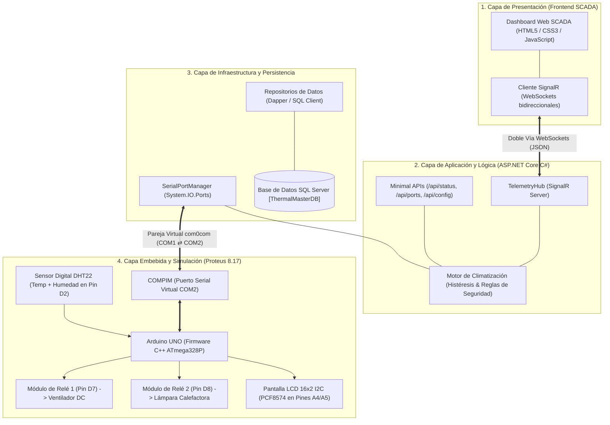

# Documentación de Arquitectura de Software y Hardware (Versión Definitiva)

# Sistema Inteligente de Monitoreo y Control Ambiental (SCADA)
### Microcontrolador Arduino UNO • Sensor DHT22 • Relés D7/D8 • LCD 16x2 I2C • Proteus 8.17

---

## 1. Arquitectura General del Sistema

El sistema implementa una **Arquitectura en 4 Capas Desacopladas**, adaptada para el control ambiental de temperatura y humedad en tiempo real:



---

## 2. Diagrama de Funcionamiento y Secuencia de Control

```mermaid
sequenceDiagram
    autonumber
    actor Operador as Operador Web (Dashboard SCADA)
    participant UI as Dashboard JavaScript
    participant Hub as SignalR TelemetryHub (C#)
    participant Serial as SerialPortManager (C#)
    participant COMPIM as COMPIM (COM2 / Proteus)
    participant Arduino as Arduino UNO
    participant Sensores as Sensor Digital DHT22 (Pin D2)
    participant Actuadores as Relés D7 (Ventilador) / D8 (Lámpara)
    participant DB as SQL Server

    rect rgb(10, 25, 45)
    Note over Arduino,Actuadores: CICLO 1: Telemetría Continua (Cada 1000 - 1500 ms)
    Arduino->>Sensores: Pulso de inicio 1-Wire
    Sensores-->>Arduino: Trama digital 40 bits (Temperatura en °C y Humedad en %)
    Arduino->>Arduino: Evaluación de Histéresis: <18°C Lámpara ON | 18-28°C Confort | >28°C Ventilador ON
    Arduino->>Actuadores: Actualización de Relé D7 y Relé D8 (con enclavamiento de seguridad)
    Arduino->>Arduino: Actualización de Pantalla LCD 16x2 vía I2C (Pines A4/A5)
    Arduino->>COMPIM: Trama Serial: {"temp":24.5,"hum":55.0,"fan":0,"lamp":0,"mode":"AUTO","alarm":0}\n
    COMPIM->>Serial: Transmisión UART por pareja com0com (COM2 -> COM1)
    Serial->>Hub: Dispara evento TelemetryReceived
    Hub->>UI: Notificación WebSocket ReceiveTelemetry(...)
    UI->>Operador: Refresco en tiempo real de Termómetro, Humedad, Aspas y Lámpara
    Hub->>DB: Registro en tabla [SensorReadings]
    end

    rect rgb(20, 35, 20)
    Note over Operador,Actuadores: CICLO 2: Control Manual Directo (Comando de Operador)
    Operador->>UI: Clic en "ENCENDER LÁMPARA" (o Ventilador)
    UI->>Hub: Invocación SignalR SendControlCommand("LAMP_ON")
    Hub->>Serial: SendCommandAsync({"cmd":"LAMP_ON"}\n)
    Serial->>COMPIM: Transmisión UART por COM1 -> COM2
    COMPIM->>Arduino: Lectura de trama de comando en buffer UART
    Arduino->>Actuadores: Conmuta Pin D8 = HIGH (Relé de la lámpara cierra contacto)
    Arduino->>COMPIM: Responde confirmación: {"ack":"LAMP_ON","status":"OK"}\n
    COMPIM->>Serial: Lectura de confirmación ACK
    Serial->>Hub: Confirma ejecución exitosa
    Hub->>UI: Notifica ReceiveCommandAck("LAMP_ON", true)
    UI->>Operador: Mensaje en consola SCADA: "Lámpara encendida correctamente"
    Hub->>DB: Registro de auditoría en tabla [DeviceCommands]
    end
```



---

## 3. Matriz Definitiva de Pines (Sin Conflictos)

| Pin Arduino | Tipo | Dispositivo Conectado | Pin del Dispositivo | Función / Justificación |
| :--- | :--- | :--- | :--- | :--- |
| **D0 (RX)** | Digital IN | COMPIM de Proteus | Pin 3 (TXD del COMPIM) | Recepción de órdenes desde el software C# |
| **D1 (TX)** | Digital OUT | COMPIM de Proteus | Pin 2 (RXD del COMPIM) | Transmisión de telemetría hacia el software C# |
| **D2** | Digital Bidireccional | Sensor DHT22 (AM2302) | Pin 2 (DATA / OUT) | Comunicación digital 1-Wire (Temperatura y Humedad) |
| **D7** | Digital OUT | Módulo de Relé 1 | Pin IN1 del Relé | Control del ventilador (HIGH = Enfriamiento ON) |
| **D8** | Digital OUT | Módulo de Relé 2 | Pin IN2 del Relé | Control de la lámpara (HIGH = Calefacción ON) |
| **A4 (SDA)** | Bus I2C Datos | Display LCD 16x2 I2C | Pin SDA del adaptador PCF8574 | Transmisión de caracteres y comandos en 2 hilos |
| **A5 (SCL)** | Bus I2C Reloj | Display LCD 16x2 I2C | Pin SCL del adaptador PCF8574 | Señal de reloj de sincronización I2C |
| **5V / GND** | Alimentación | Todos los componentes | VCC (+5V) y Masa (GND) | Buses de potencia y referencia eléctrica común |

> **Nota de Verificación:** Los pines D3, D4, D5, D6, D9, D10, D11, D12 y D13 quedan completamente libres. La pantalla LCD opera mediante I2C en A4/A5, eliminando la necesidad de los 6 pines digitales requeridos en displays paralelos antiguos.

---

## 4. Protocolo de Comunicación Serial UART

### Parámetros Físicos
- Velocidad: **9600 baudios**
- Formato: **8 bits de datos, sin paridad, 1 bit de parada (8-N-1)**
- Terminador: **Salto de línea `\n`**

### Trama de Telemetría (Arduino -> PC)
```json
{"temp":25.4,"hum":55.0,"fan":0,"lamp":0,"mode":"AUTO","alarm":0}
```

### Tramas de Control (PC -> Arduino)
- Encender ventilador: `{"cmd":"FAN_ON"}\n` $\longrightarrow$ ACK: `{"ack":"FAN_ON","status":"OK"}\n`
- Apagar ventilador: `{"cmd":"FAN_OFF"}\n` $\longrightarrow$ ACK: `{"ack":"FAN_OFF","status":"OK"}\n`
- Encender lámpara: `{"cmd":"LAMP_ON"}\n` $\longrightarrow$ ACK: `{"ack":"LAMP_ON","status":"OK"}\n`
- Apagar lámpara: `{"cmd":"LAMP_OFF"}\n` $\longrightarrow$ ACK: `{"ack":"LAMP_OFF","status":"OK"}\n`
- Modo automático: `{"cmd":"SET_MODE","val":"AUTO"}\n` $\longrightarrow$ ACK: `{"ack":"SET_MODE","val":"AUTO"}\n`
- Modo manual: `{"cmd":"SET_MODE","val":"MANUAL"}\n` $\longrightarrow$ ACK: `{"ack":"SET_MODE","val":"MANUAL"}\n`
- Modificar umbrales: `{"cmd":"SET_LIMITS","min":18.0,"max":28.0}\n` $\longrightarrow$ ACK: `{"ack":"SET_LIMITS","status":"OK"}\n`
